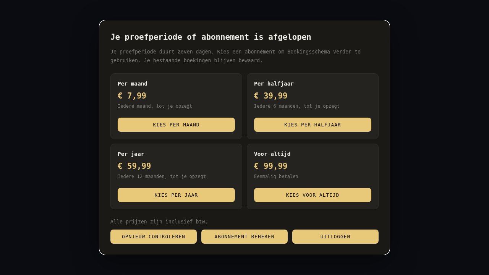

# Proefperiode en abonnementen

Deze branch bevat de proefweek, het keuzescherm, de toegangscontrole en de
Stripe-koppeling. **De functie staat standaard uit.** Voor gebruik zijn een eigen
Stripe-account, privé ingestelde sleutels, een webhook en activering nodig.
De live app en bestaande accounts zijn vanuit deze werkmap niet aangepast.
Zie [de Windows-handleiding](stripe-activeren-windows.md) voor de knoppen en opdrachten.



| Optie | Prijs inclusief btw | Betaling |
| --- | --- | --- |
| Per maand | €7,99 | Iedere maand |
| Per halfjaar | €39,99 | Iedere zes maanden |
| Per jaar | €59,99 | Iedere twaalf maanden |
| Voor altijd | €99,99 | Eén keer |

De vijf bestaande accounts krijgen gratis blijvende toegang. Het
inrichtingsscript onthoudt hun UID's; later aangemaakte gebruikers krijgen bij
opnieuw uitvoeren van het script geen gratis blijvende toegang.

## Gedrag zodra de functie wordt ingeschakeld

1. Een gebruiker registreert met een uitnodigingscode en bevestigt het e-mailadres.
2. Bij de eerste bevestigde login legt Firestore de starttijd vast. De proefperiode
   duurt precies zeven keer 24 uur en is op alle apparaten hetzelfde.
3. Tijdens de proefperiode werken de bestaande boekingsfuncties.
4. Na afloop verschijnt een venster midden op het scherm met **per maand**, **per
   halfjaar**, **per jaar** en **voor altijd**. Op een telefoon staan de opties onder
   elkaar. Je kunt opnieuw controleren of uitloggen; het venster kan niet worden
   weggeklikt om de app verder te gebruiken.
5. Boekingen blijven bewaard. De database en beschermde serverfuncties weigeren
   gebruik na afloop, ook als iemand het venster via de browser verwijdert.
6. Een vertrouwd vastgelegde betaling kan toegang herstellen zonder een nieuw
   account of een nieuwe proefweek. Alleen een beveiligde serverkoppeling of de
   hoofdbeheerder mag betaalde toegang vastleggen.

Er wordt tijdens de proefweek niets afgeschreven. Na de proefweek kiest de
gebruiker zelf een betaaloptie en rekent af via Stripe Checkout. De drie
abonnementen verlengen periodiek; levenslang is één betaling. Bij bevestigde
toegang kan de gebruiker via **Profiel → Abonnement en facturen beheren** naar
het Stripe-klantenportaal. Daar zijn betaalgegevens, facturen en opzeggen
beschikbaar zodra de eigenaar het portaal in Stripe heeft ingesteld.

## Stripe en toegang

De server kiest de prijs op basis van de vier ingestelde opties. Een browser
kan geen eigen bedrag, UID, aantal, prijs-ID of terugkeeradres doorgeven. Bij
afrekenen controleert de server de Stripe-prijs, valuta, btw-instelling,
looptijd en metadata. Gelijktijdige verzoeken gebruiken een verwerkingsslot;
een bestaande open betaalpagina wordt hergebruikt of verlopen verklaard bij
een andere keuze. Een lopend abonnement verhindert een tweede abonnement.

De webhook controleert de Stripe-handtekening op de originele requestbody.
Daarna wordt de actuele toestand bij Stripe opgevraagd. Een oud, dubbel of
verkeerd geordend betaalbericht kan een terugbetaalde betaling daardoor niet
opnieuw activeren. Een betaling die nog wordt verwerkt geeft nog geen toegang.
De betaalde factuurperiode bepaalt de einddatum; een mislukte verlenging voegt
geen nieuwe maand toe. Volledig terugbetaalde of betwiste betalingen geven
geen toegang. Gratis vrijstellingen blijven behouden.

Bij een vertraagde webhook kan **Opnieuw controleren** de actuele Stripe-status
ophalen. Alleen terugkomen op `?betaling=geslaagd` geeft geen toegang. Bij
storing blijven bestaande einddatums gelden. De databaseregels blijven van
toepassing ongeacht de zichtbaarheid van het keuzescherm.

Deze beveiliging weigert nieuwe serververzoeken na afloop. Gegevens die iemand
tijdens geldige toegang al heeft opgehaald, kunnen nog in browsergeheugen of
een eigen export bestaan. Een webapp kan eerder opgehaalde gegevens niet
terughalen. Het keuzescherm wist de lokale boekingslijst van de app.

De code gebruikt Stripe SDK 23.0.0 met API `2026-09-30.endive`. Configureer
opzegging aan het einde van de betaalde periode. Wijzigen van prijs of aantal
via het Stripe-portaal staat bij deze eerste versie uit: een andere optie
kan na afloop worden gekozen.

## Publiceren en activeren

Een Netlify branch deploy van `proefperiode-abonnementen` kan de voorbereide code
bevatten. Het keuzescherm verschijnt pas als de functie in Firebase is aangezet.
Verander de productiebranch hiervoor nog niet.

De juiste volgorde voor de uiteindelijke activering is:

1. Stripe-account en privé instellingen klaarzetten volgens de Windows-handleiding.
2. De koppeling met de testomgeving van Stripe controleren:
   geslaagd, geannuleerd, mislukt, verlopen, dubbel ontvangen betaalbericht en
   terugkeer naar de app. Toegang mag nooit op basis van alleen een browserlink
   naar een succespagina worden toegekend.
3. Een nieuwe privéback-up maken met `scripts/backup-firestore.cjs`.
4. De bijgewerkte databaseregels publiceren. Zolang `billing/config` ontbreekt of
   `enabled: false` bevat, houden bestaande gebruikers hun huidige toegang.
5. De nieuwe frontend en **alle Netlify Functions** samen publiceren. De frontend
   gebruikt ook bij uitgeschakelde abonnementen de statusfunctie. Een losse
   statische upload zonder werkende Functions kan de login dus niet afhandelen.
6. Met het inrichtingsscript de vijf bestaande accounts gratis toegang geven en
   de prijzen voorbereiden, terwijl de functie nog uitstaat. De hoofdbeheerder
   met de vertrouwde `admin`-claim blijft toegang houden.
7. Pas daarna de functie inschakelen en met een apart testaccount controleren.

Zet `enabled` pas op `true` nadat de providerinstellingen, functies en webhook
gereed zijn. Gebruik daarvoor het afzonderlijke activeringscommando in de
handleiding. Het eerste inrichtingscommando activeert de functie niet.

Een Netlify preview die hetzelfde Firebase-project gebruikt deelt echte gegevens
en toegangsinstellingen met de live app. Gebruik voor betaal- en verlooptests
een apart Firebase-testproject met fictieve accounts. Een preview maakt geen
aparte database aan.

## Gegevens en beveiliging

`billing/config` is na bevestigde login leesbaar, en alleen door de hoofdbeheerder
te wijzigen. Het is publieke productconfiguratie voor ingelogde gebruikers en
mag **geen geheime betaal- of serviceaccountsleutels** bevatten.

- `enabled`: boolean. Ontbrekend document of expliciet `false`: functie uit.
- `provider`: `stripe`.
- `taxIncluded`: alleen `true` als de vier prijzen daadwerkelijk inclusief btw zijn.
- `plans`: map met `maand`, `halfjaar`, `jaar`, `levenslang`. Iedere optie heeft
  `amountCents`: een positief geheel aantal eurocenten, en een `stripePriceId`.
  Ontbrekende of ongeldige
  prijzen tonen “Prijs nog niet ingesteld” en kunnen niet worden gekozen.

`billingAccess/{Firebase-uid}` bevat de vertrouwde toegangsstatus:

| status | Betekenis | Extra veld |
| --- | --- | --- |
| `trial` | Zeven dagen proefgebruik | `trialStartedAt`, Firestore Timestamp |
| `active` | Toegang tot een bepaalde datum | `validUntil`, Firestore Timestamp |
| `lifetime` | Eenmalig betaalde blijvende toegang | — |
| `free` | Door eigenaar vrijgesteld | — |

Een bevestigd en gekoppeld account mag uitsluitend zijn eerste `trial`-document
aanmaken met de **Firestore-servertijd**. Het kan dit document niet wijzigen,
verwijderen of verlengen. Betaalde rechten worden nooit uit browseropslag,
een zelf opgegeven prijs, datum of URL-parameter overgenomen. Profiel en eigen
toegangsstatus blijven na afloop leesbaar voor inloggen en de abonnementskeuze.

Stripe-klanten, tijdelijke checkoutgegevens, verwerkingssloten en ontvangen
bericht-ID's staan in `billingCustomers`, `billingCheckout`, `billingLocks` en
`billingEvents`. Browsergebruikers kunnen deze collecties niet rechtstreeks
lezen of wijzigen. Alleen geverifieerde servercode gebruikt deze gegevens.
Het inrichtingsscript legt de vijf oorspronkelijke UID's vast in `billing/setup`.

De statusfunctie gebruikt een geverifieerd Firebase-token en de Firestore REST
API met datzelfde gebruikerstoegangstoken. Voor de proefperiode zijn geen
serviceaccountsleutels op Netlify nodig. Stripe-checkout, betaalwebhooks en
hercontrole gebruiken wel een privé serviceaccount voor vertrouwde schrijftoegang.
Geheime waarden staan uitsluitend in Netlify Functions-omgevingsvariabelen;
zie `.env.example`. De server weigert live betalingen zolang
`BILLING_LIVE_ENABLED` niet expliciet `true` is. Een bekende preview-context
weigert live betalingen eveneens.

## Automatische controle

```sh
npm test
npm run test:security
```

De tests gebruiken uitsluitend lokale Firebase-emulators en een nagebootste
Stripe API. De webhookhandtekening wordt met de echte Stripe-SDK gecontroleerd.
Ze controleren de exacte grens van zeven dagen, niet kunnen herstarten of
zelf betaalde toegang toekennen, verlopen toegang op de database en API, behouden boekingen,
sessieherstel, vier opties, telefoonformaat, aflopen terwijl de app openstaat,
herstel na vertrouwde toekenning en opnieuw proberen na een tijdelijke storing.
Ze controleren ook prijsvervalsing, dubbele checkouts, late en dubbele
webhooks, terugbetaling, mislukte verlenging, het eigen klantenportaal en het
eenmalig vrijstellen van de vijf oorspronkelijke accounts. Er is in deze
werkomgeving geen Stripe Sandbox-checkout afgerond en er is geen echte
betaling uitgevoerd. Dat vereist het eigen Stripe-account van de eigenaar.
